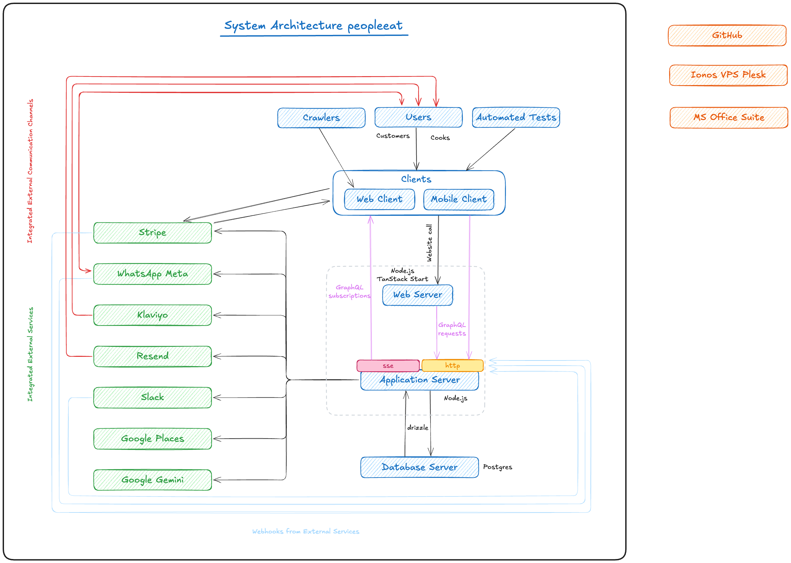

# System architecture

peopleeat runs as **one Node process in one container**. TanStack Start serves the React site, and the same process serves GraphQL
(`POST /api/graphql`) and subscriptions (`/api/stream`). PostgreSQL holds application data (Drizzle), the pg-boss job queue, and the
NOTIFY/LISTEN channels that fan subscriptions out. GitHub Actions builds the image, pushes it to GHCR, and Coolify runs it behind Traefik.

The sketch is a map of that shape. The files below are the specification. Per-area decisions stay in the other docs under
`docs/architecture/`; the index is the architecture table in [`AGENTS.md`](../../AGENTS.md).

## Reading the sketch

- **Clients.** Browsers load the React site. Crawlers fetch the same HTML ([discovery-seo.md](./discovery-seo.md),
  [discovery-geo.md](./discovery-geo.md)). Playwright drives the site in CI ([e2e.md](./e2e.md)) and also runs inside the server for capture
  ([browser-capture.md](./browser-capture.md)). The only client is that site.
- **One Node process.** The "web server" and "application server" boxes are the same container. Queries and mutations are HTTP.
  Subscriptions are SSE on `/api/stream`, fed by Postgres NOTIFY/LISTEN. See [api-layer.md](./api-layer.md) and
  [state-synchronization.md](./state-synchronization.md). Code layout inside the process is
  [server-architecture.md](./server-architecture.md) and [dependency-injection.md](./dependency-injection.md).
- **Database.** Drizzle talks to Postgres. pg-boss uses that same database for the job queue. See [jobs.md](./jobs.md).
- **Outside services.** The process calls Stripe, Meta WhatsApp, Resend, Klaviyo, Slack, Google Places, and Gemini. Stripe, Resend,
  WhatsApp, and Slack call back on signed webhook routes. Slack is one integration. Klaviyo (marketing profiles) and Resend (transactional
  mail) are separate systems. WhatsApp and email reach the user because the app sends them.
  - Stripe: [stripe-payment.md](./stripe-payment.md)
  - WhatsApp: [whatsapp.md](./whatsapp.md)
  - Resend: [outbound-email.md](./outbound-email.md)
  - Klaviyo: [klaviyo-profile-sync.md](../features/klaviyo-profile-sync.md)
  - Slack: [slack-notifications.md](../features/slack-notifications.md)
  - Google Places: [cook-profile.md](../features/cook-profile.md)
  - Gemini: [ai-generations.md](./ai-generations.md), [agent-delegation.md](./agent-delegation.md)
- **Deploy.** Source and CI are GitHub, images are GHCR, runtime is Coolify behind Traefik. See [infrastructure.md](../infrastructure.md).

Not on the sketch yet:

- LiveKit for offer calls — [booking-request-offer-calls.md](../features/booking-request-offer-calls.md)
- `FileUploads` in Postgres and Garage for larger objects — [file-storage.md](./file-storage.md)
- OpenTelemetry, Langfuse, and Grafana — [observability.md](./observability.md)
